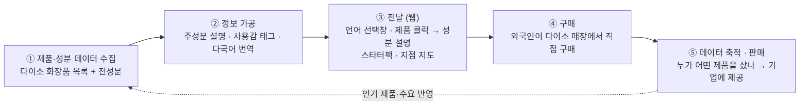
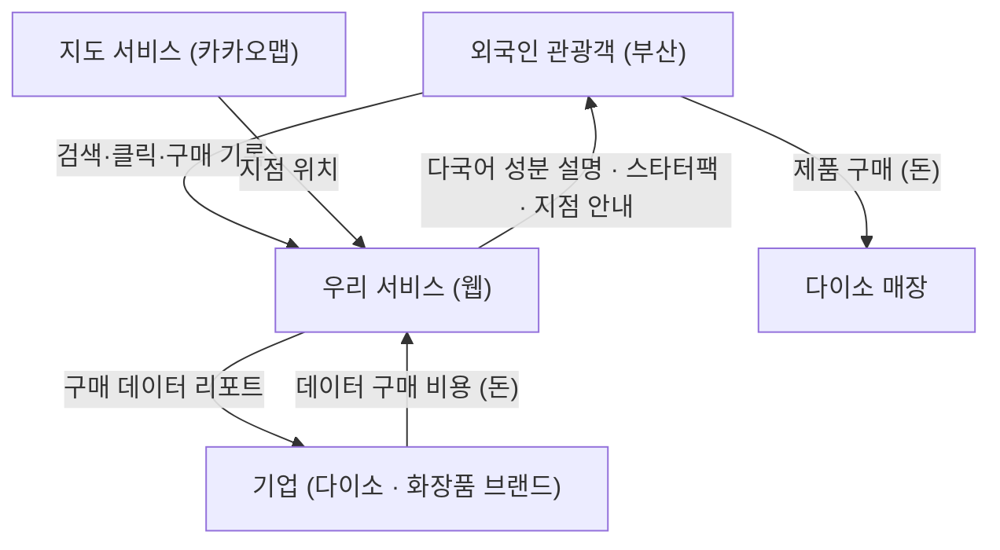

# 밸류체인 맵 · 부산 방문 외국인을 위한 다이소 화장품 성분 안내 서비스

- 작성일: 2026-11-25
- 근거: 송성민 아이디어 메모(2026-11-25 채팅). 외부 자료는 아직 조사하지 않았습니다.
- 표시 규칙: 팀이 직접 본 것은 **[관찰]**, 아직 확인하지 않은 것은 `[확인 필요: …]`, 우리가 추측하는 것은 **가설:** 로 적었습니다.

---

## 0. 한 줄 정의

> 부산에 온 외국인이 **다이소 화장품의 성분과 사용감을 자기 나라 말로** 쉽게 알 수 있게 해 주고, 실제 구매로 이어진 데이터를 **기업에 파는** 서비스.
> 부가 서비스: 스킨케어를 처음 하는 남성을 위한 **"이것부터 써 보세요" 스타터팩**.

---

## 1. 문제 (출발점)

| 구분 | 올리브영 | 다이소 |
|---|---|---|
| 매장 직원 외국어 응대 | 가능 **[관찰]** | `[확인 필요: 직원 외국어 응대 여부]` |
| 셀프결제 | — | 언어 선택만 있음 **[관찰]** |
| 제품 고를 때 성분·효과 정보 | 직원 설명·정보가 많음 **[관찰]** | 제품을 고를 때 볼 정보가 없음 **[관찰]** |
| 가격대 | `[확인 필요]` | 저가 (아이디어 메모에는 "5천원짜리부터"라고 적힘) `[확인 필요: 실제 가격대]` |

- **가설:** 설명을 들어도 한국 화장품이 낯선 사람(특히 남성)은 결국 무엇이 좋은지 잘 모른다.
- **가설:** 처음 시작하는 사람은 비싼 올리브영보다 싼 다이소에서 시작하는 걸 더 편하게 느낀다.

---

## 2. 밸류체인 한눈에 보기

**흐름 요약:** 정보(①~③) → 구매(④) → 데이터(⑤) → 다시 정보 개선(①)으로 돌아오는 순환 구조.

---

## 3. 단계별 상세

### ① 제품·성분 데이터 수집 (투입)

| 항목 | 내용 |
|---|---|
| 하는 일 | 다이소에서 파는 스킨케어 제품 목록과 각 제품의 전성분 모으기 |
| 근거 | 성분은 제품마다 표기되어 있어 간단하게라도 설명할 수 있다 (아이디어 메모) |
| 필요한 것 | 제품 목록, 전성분 표, 가격, 사진 |
| 확인할 것 | `[확인 필요: 다이소 공식몰/앱에 전성분이 공개되는지]` `[확인 필요: 제품 정보 사용 시 저작권·이용약관]` |

### ② 정보 가공 (핵심 가치를 만드는 단계)

| 항목 | 내용 |
|---|---|
| 하는 일 | 전성분 중 **주성분** 골라 쉬운 말로 설명 (기존 규칙: 효능을 실제로 내는 성분 최대 4개) |
| 사용감 태그 | 촉촉함 / 찐득함 / 수분감 / 끈적임 등 — 처음 쓰는 사람이 바로 이해할 수 있는 말 |
| 다국어 | 언어별 설명 만들기 `[확인 필요: 부산 방문 외국인 국적 순위 — 어떤 언어부터 할지]` |
| 차별화 | "○○가 얼굴에 좋다"를 **솔직하고 쉽게** 설명 — 올리브영보다 자료는 적어도 핵심만 |

### ③ 전달 (웹 서비스)

| 기능 | 내용 | 재사용 |
|---|---|---|
| 언어 선택창 | 첫 화면에서 언어 고르기 | 신규 |
| 제품 클릭 → 성분 설명 | 제품을 누르면 상세 정보와 성분 설명이 뜸 | 맥주 프로젝트 화면 구조 재사용 |
| 지점 찾기 | 부산 다이소 지점을 지도로 안내 | 맥주 프로젝트 카카오맵 연동 경험 재사용 `[확인 필요: 다이소 지점 목록 출처]` |
| 스타터팩 (부가) | 남성 초보자용 "이것부터 써 보세요" 세트 추천 | 신규 |

### ④ 구매 (고객 행동)

| 항목 | 내용 |
|---|---|
| 하는 일 | 외국인이 웹에서 고른 제품을 **다이소 매장에서 직접** 산다 |
| 배송 | 하지 않음 — 배송으로 돈을 버는 구조가 아님 (아이디어 메모) |
| 고객이 얻는 것 | 싼 가격 + 원하는 정보를 쉽게 얻음 |
| 확인할 것 | `[확인 필요: 웹에서 본 제품을 실제로 샀는지 어떻게 기록할지 — 예: 쿠폰, 바코드, 설문]` |

### ⑤ 데이터 축적·판매 (수익)

| 항목 | 내용 |
|---|---|
| 모으는 데이터 | 어떤 사람(국적·성별 등)이 어떤 제품을 사 갔는지 |
| 파는 대상 | 다이소, 다이소 납품 화장품 브랜드 등 기업 |
| 수익 방식 | 다이소에 맞춘 데이터 리포트 판매 |
| 주의 | `[확인 필요: 개인정보 수집·제3자 제공 시 법적 요건]` |
| 가설 | 가설: 기업은 "외국인 관광객이 다이소에서 무엇을 사는지" 데이터에 돈을 낼 것이다 — 아직 기업에 확인하지 않음 |

---

## 4. 참여자와 주고받는 것

| 참여자 | 주는 것 | 받는 것 |
|---|---|---|
| 외국인 관광객 | 구매·클릭 기록 | 쉬운 다국어 성분 정보, 지점 위치 |
| 다이소 매장 | 제품 | 매출 (외국인 손님 증가 — 가설) |
| 우리 서비스 | 정보, 데이터 리포트 | 데이터 판매 수익 |
| 기업 | 데이터 구매 비용 | 외국인 구매 패턴 데이터 |

---

## 5. 우리만의 강점 (차별화)

1. **싸다** — 다이소 가격대로 부담 없이 시작
2. **쉽다** — 사용감 태그(촉촉함·찐득함 등)와 짧은 성분 설명
3. **내 나라 말로** — 셀프결제처럼 언어만 바꾸는 게 아니라 제품 정보까지 번역
4. **초보 맞춤** — 남성 스킨케어 입문 스타터팩

---

## 6. 다음에 확인할 것 (리서치 목록)

1. `[확인 필요: 부산 방문 외국인 수와 국적 — 한국관광공사·부산시 등 공공기관 통계]`
2. `[확인 필요: 다이소 화장품 전성분 공개 여부와 수집 방법]`
3. `[확인 필요: 부산 다이소 지점 목록]`
4. `[확인 필요: 다이소 매장 외국어 지원 현황 (직원·셀프결제)]`
5. `[확인 필요: 데이터 판매 시 개인정보 관련 법]`
6. `[확인 필요: 비슷한 서비스가 이미 있는지]`
