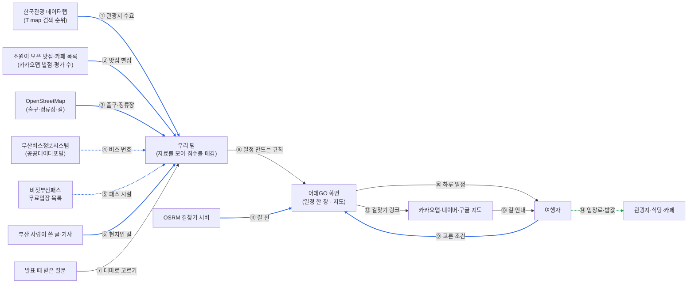

# 밸류체인 맵 — 어데GO (부산 구별 여행 경로) · 2026-11-25

> 짝 팀이 읽을 맵입니다. 읽은 파일: `sunghan/busan-routes_초안_v27_한파일.html`(이하 **v27**). 괄호 속 `v27:줄`은 그 파일의 줄 번호입니다.

[1. 맵의 목적] 여행자가 "누구와·언제·어떻게"만 고르면 차 없이 다니는 하루 일정을 받기까지, 무엇이 어디서 어디로 흐르는지 보여 준다
[2. 판단 기준] 근거 파일이 있는 화살표만 실선으로 그린다. 근거 파일을 못 찾은 것은 점선으로 그리고 [확인 필요]를 붙인다
[3. 대상 / 뺀 것] 대상: 부산을 찾는 20~30대 여행자(`sunghan/CLAUDE.md` 3칸) / 뺀 것: 화면 꾸밈(캐릭터 그림·색), 다른 팀 맵과 비교하기

## 그림

**보는 법:** 실선 = 근거 파일 있음 · 점선 = 근거 파일 못 찾음 · 파랑 = 데이터 · 초록 = 돈 · 검정 = 화면·안내

## 화살표 표

| 번호 | 무엇이 | 어디서 → 어디로 | 근거 파일 | 상태 |
|---|---|---|---|---|
| ① | 관광지 수요(달마다 많이 찾는 곳) | 한국관광 데이터랩 → 우리 팀 | `jaehee/data/raw/한국관광데이터랩_부산구군별_내비검색_Top30_월별_202301-202610_20261117.csv` · v27:3067 | 확정 |
| ② | 맛집·카페 별점과 평가 수(225곳) | 조원 목록 → 우리 팀 | `hyebeen/부산_구별_맛집_카페_리스트.xlsx` · v27:3074 | 확정 · v27이 적은 파일 이름(`부산_구별_맛집10_카페5_리스트.csv`)과 달라 [확인 필요] |
| ③ | 지하철 출구·버스 정류장 이름·숨은 길 위치 | OpenStreetMap → 우리 팀 | `sunghan/research/osm-v7/` · `sunghan/research/2026-11-19-data-license.md` · v27:3721 | 확정 |
| ④ | 정류장마다 지나는 버스 번호 | 부산버스정보시스템 → 우리 팀 | v27:3734에 받은 날(2026-11-23)만 있음 · 받은 원본 파일 못 찾음 | [확인 필요] |
| ⑤ | 패스로 무료 입장하는 시설(34곳) | 비짓부산패스 → 우리 팀 | v27:3276에 목록만 있음 · 출처 원문 파일 못 찾음 | [확인 필요] |
| ⑥ | 부산 사람이 직접 쓴 추천 길 | 글·기사 → 우리 팀 | `sunghan/research/2026-11-20-local-routes.md` | 확정 |
| ⑦ | "구별보다 테마별로 나누면 고르기 쉽겠다" | 발표 청중 → 우리 팀 | v27:3350 주석(2026-11-25) · 따로 적은 회의 파일 없음 | 확정(주석만) |
| ⑧ | 일정 만드는 규칙(믿음 점수, 계절 메뉴, 비 오는 날 플랜 B) | 우리 팀 → 화면 | v27:3132 출처 목록 | 확정 · 계절 메뉴 규칙은 팀 의견이라 통계 근거 [확인 필요] |
| ⑨ | 누구와·몇 명·며칠·언제·이동·테마 | 여행자 → 화면 | v27:3341 (여행자 브라우저에만 저장, 우리 팀에 안 옴) | 확정 |
| ⑩ | 하루 일정과 이동 시간(추정) | 화면 → 여행자 | v27 STEP 5 화면 | 확정 |
| ⑪ | 실제 도로·걷기 길 선 | OSRM 서버 → 화면 | v27:3830 | 확정 |
| ⑫ | 출발·도착을 넣은 길찾기 주소 | 화면 → 지도 앱 | v27:3577 | 확정 |
| ⑬ | 실제 길 안내 | 지도 앱 → 여행자 | v27:3577 (링크만, 그 뒤는 지도 앱 몫) | 확정 |
| ⑭ | 입장료·밥값 | 여행자 → 관광지·가게 | 근거 파일 없음 | [확인 필요] |

**우리 팀으로 들어오는 돈:** 화살표가 없습니다. 돈을 받는 방법을 적은 파일을 못 찾았습니다.
**여행자에게서 우리 팀으로 오는 데이터:** 없습니다. ⑨는 여행자 브라우저에 머뭅니다.

## 여행자가 거치는 단계

| 번호 | 단계 (화면 문구 그대로) | 누가 | 우리 팀이 손대나 | 이어지는 화살표 |
|---|---|---|---|---|
| 1 | 갈 만한 곳과 밥집을 모은다 | 우리 팀 | 예 | ① ② ③ ④ ⑤ ⑥ |
| 2 | 그 달에 많이 찾는 곳, 믿을 만한 집을 먼저 고른다 | 우리 팀 | 예 | ⑧ |
| 3 | 누구랑 떠나요? | 여행자 (우리 화면) | 예 | ⑨ |
| 4 | 언제, 며칠 동안? | 여행자 (우리 화면) | 예 | ⑨ |
| 5 | 어떻게 다닐까요? | 여행자 (우리 화면) | 예 | ⑨ |
| 6 | 어떤 여행을 할까요? (테마 · 구 고르기) | 여행자 (우리 화면) | 예 | ⑦ ⑨ |
| 7 | 추천 일정이 나왔어요 | 우리 화면 | 예 | ⑩ |
| 8 | 지도에서 길 따라가기 | 우리 화면 + OSRM | 일부 (길 선은 OSRM) | ⑪ |
| 9 | 지도 앱으로 길을 찾아 이동한다 | 카카오맵·네이버·구글 지도 | 아니요 (링크만 건넴) | ⑫ ⑬ |
| 10 | 구경하고 먹고 돈을 쓴다 | 관광지·가게 | 아니요 | ⑭ |
| 11 | 여행이 어땠는지 알려 준다 | 없음 | 아니요 (길이 없음) | — |

**한 줄 요약:** 우리 팀은 1~8단계에 손대고, 9단계부터는 다른 곳에 넘깁니다. 11단계(여행자가 돌아와 알려 주는 길)는 아직 없습니다.

## 체크리스트 넷 — 우리가 먼저 본 것

- ① 화살표마다 근거 파일이 있나: 14개 가운데 ④ ⑤ ⑭는 원본 파일을 못 찾아 점선입니다. ⑦은 v27 주석뿐입니다.
- ② 단계 이름이 고객이 알아듣는 말인가: 3~7단계는 화면 문구를 그대로 옮겼습니다. 1·2단계는 우리 팀 일이라 여행자가 보는 말이 아닙니다.
- ③ 데이터 화살표가 있나: 파랑 8개(① ~ ⑥ ⑨ ⑪). 여행자 → 우리 팀으로 오는 데이터 화살표는 없습니다.
- ④ 우리 팀이 실제로 손대는 단계가 보이나: 위 단계 표의 "우리 팀이 손대나" 칸에 적었습니다.
