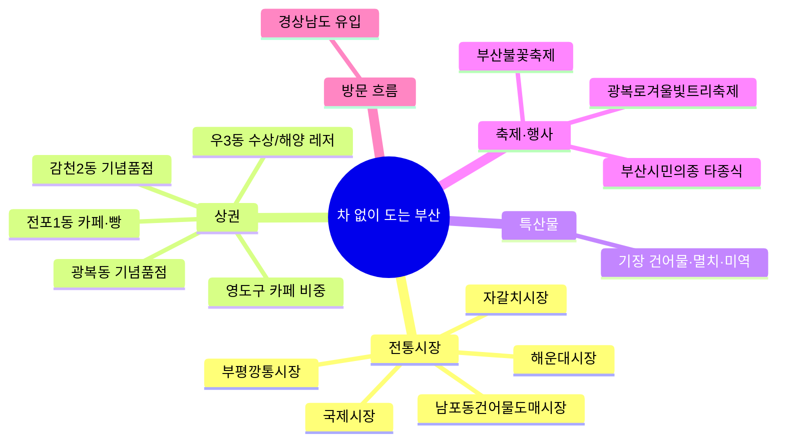

# 부산 지역 키워드 맵 · sunghan · AX 데이터·서비스 트랙

> 키워드 하나 = 리서치 노트 하나. 노트를 만들면 '노트' 칸에 파일 이름을 적습니다.
> 근거의 파일은 모두 `llm-academy/inputs/`에 있습니다. 엑셀 행은 머리줄이 1행입니다. 확인일은 2026-11-18입니다.
> inputs에는 대중교통 정보가 없습니다. 그래서 '차 없이 갈 수 있는가'는 모든 키워드에서 아직 확인 필요입니다.
> 숫자의 성격(CLAUDE.md [2]-2): `등록값`은 공공데이터 CSV에 등록된 값(시장·상권·축제)이고 실측이 아닙니다. `추정`은 datalab 값입니다(가설: 통신 데이터 기반 추정. 산출 방식은 파일에 없음). 두 성격의 숫자는 섞어 계산하지 않습니다.
> 시장 순위는 busan_markets.csv 158개 시장의 점포수 내림차순이며, 같은 점포수는 공동 순위입니다.

## 가운데 질문

차 없이 다니는 20~30대 여행자의 부산 경로(GREEN ROUTE BUSAN)에 넣을 시장·동네·행사는 어디일까?

## 키워드 표

| 묶음 | 키워드 | 왜 골랐나 (셀 수 있는 것·숫자·분모 열) | 근거 (inputs 파일 엑셀 행, 확인일) | 노트 | 상태 |
|---|---|---|---|---|---|
| 전통시장 | 자갈치시장 | 점포수 223(등록값, 158개 시장 중 21위). 같은 장소에서 부산자갈치축제(10-15~10-18)가 열림 | busan_markets.csv 157행, busan_festivals.csv 30행, 2026-11-18 | `research/2026-11-18-jagalchi-market.md` | 확인함 |
| 전통시장 | 국제시장 | 점포수 500(등록값, 158개 시장 중 9위), 개설연도 1948 | busan_markets.csv 156행, 2026-11-18 | (아직 없음) | 확인함 |
| 전통시장 | 부평깡통시장 | 점포수 320(등록값, 158개 시장 중 12위), 개설연도 1910 | busan_markets.csv 152행, 2026-11-18 | (아직 없음) | 확인함 |
| 전통시장 | 남포동건어물도매시장 | 점포수 141(등록값, 158개 시장 중 42위). 유라리 건맥축제 개최 장소에 이름이 나옴 | busan_markets.csv 155행, busan_festivals.csv 24행, 2026-11-18 | `research/2026-11-12-nampodong-dried-seafood-wholesale-market.md` | 확인함 |
| 전통시장 | 해운대시장 | 점포수 110(등록값, 158개 시장 중 공동 61위, 대신시장과 같음), 개설연도 1910 | busan_markets.csv 71행, 2026-11-18 | (아직 없음) | 확인함 |
| 상권 | 전포1동 카페·빵 | (등록값) 카페 154곳 ÷ 부산_해당업종_점포수 7,071 = 2.18%(2위). 빵/도넛 68곳 ÷ 1,919 = 3.54%(1위). 사진촬영업도 1위(51곳 ÷ 1,078 = 4.73%) | busan_commercial_highlights.csv 3·17·227행, 2026-11-18 | (아직 없음) | 확인함 |
| 상권 | 영도구 카페 비중 | (등록값) 비알코올 224곳 ÷ 시군구_전체_점포수 4,035 = 5.55%. 부산 전체는 4.50%(7,071 ÷ 157,296) | busan_commercial_summary.csv 1039·5행, 2026-11-18 | (아직 없음) | 확인함 |
| 상권 | 감천2동 기념품점 | (등록값) 기념품점 31곳 ÷ 350 = 8.86%, 부산 1위 | busan_commercial_highlights.csv 197행, 2026-11-18 | (아직 없음) | 확인함 |
| 상권 | 광복동 기념품점 | (등록값) 기념품점 25곳 ÷ 350 = 7.14%, 부산 2위 | busan_commercial_highlights.csv 198행, 2026-11-18 | (아직 없음) | 확인함 |
| 상권 | 우3동 수상/해양 레저 | (등록값) 수상/해양 레저업 42곳 ÷ 77 = 54.55%, 부산 1위 | busan_commercial_highlights.csv 287행, 2026-11-18 | (아직 없음) | 확인함 |
| 특산물 | 기장 건어물·멸치·미역 | (등록값) 기장읍 건어물/젓갈 62곳 ÷ 296 = 20.95%(1위). 기장미역다시마축제(04-17~04-19), 기장멸치축제(04-24~04-26) | busan_commercial_highlights.csv 182행, busan_festivals.csv 10·11행, 2026-11-18 | (아직 없음) | 확인함 |
| 축제·행사 | 광복로겨울빛트리축제 | 2026-12-04~2027-01-31, 오늘 이후 열리는 행사 | busan_festivals.csv 45행, 2026-11-18 | (아직 없음) | 확인함 |
| 축제·행사 | 부산시민의종 타종식 | 2026-12-31, 용두산공원 | busan_festivals.csv 46행, 2026-11-18 | (아직 없음) | 확인함 |
| 축제·행사 | 부산불꽃축제 | 2026-11-07, 광안리해수욕장. 올해는 이미 끝남, 매년 열리는지는 표에 없음 | busan_festivals.csv 44행, 2026-11-18 | (아직 없음) | 확인 필요 |
| 방문 흐름 | 경상남도 유입 | (추정) 부산 유입 비율 64.9%로 1위. 울산 15.4%가 2위(단위 %, 방문자 수는 없음) | datalab_related_regions.csv 2·3행, 2026-11-18 | (아직 없음) | 확인함 |

## 뺀 것

| 뺀 행·키워드 | 이유 |
|---|---|
| busan_festivals.csv 3·4·5행 (장림항 부네치아 아트프리마켓, 감천문화마을 골목축제, 제28회 UN평화축제) | [2]-3 최신: 2025년에 끝난 축제 |
| busan_festivals.csv 15·17·28·32행 (한국관광공사 제공 행) | [3] 같은 글: 같은 축제의 중복 행. 부산시·구·군이 올린 13·18·27·33행과 겹침 |
| busan_markets.csv 22행 부산산업용품상협동조합 (점포수 1,400) | [3] 밖 판단: 점포 수는 많지만 산업용품이라 여행자 경로와 멂 |
| busan_commercial_highlights.csv 289행 다대1동 수상/해양 레저업 (2곳 ÷ 77) | [3] 밖 판단: 점포 2곳뿐이라 숫자로 말하기 어려움 |
| 해운대구 축제 가운데 주소가 `중동2로 11`인 행 (busan_festivals.csv 6·13·23·26·36·38·40·43행) | [3] 밖 판단: 가설: 주소가 행사장이 아니라 해운대구청 주소다(확인 필요). 경로 지도에 좌표를 쓸 수 없음 |

> [3] 제외 조건 적용 메모: '광고·체험단 글', '로그인해야 보이는 글', '공백 빼고 10자 미만인 글'은 리뷰·블로그용 조건이라 공공데이터 CSV에는 걸린 행이 0건입니다. '같은 글'은 같은 축제의 중복 행에 적용했고, '팀 자료에 근거가 없는 사람과 장면'은 키워드에 넣지 않았습니다(0건). `[3] 밖 판단`은 [3]에 적힌 조건이 아니라 이 맵을 만들며 내린 판단입니다.

## 키워드 사이 연결 (선택)

