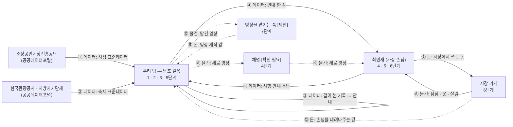

# 물건 · 돈 · 데이터가 흐르는 길 — 남포 걸음 (2026-11-24 · sunghan)

- **바꿔 읽은 것 — 사람이 확인할 것:** 맨 위 `industry/one-page.md`는 저장소에 없습니다(`sunghan/industry/`에도 없음. `steps.md:4`에도 같은 말이 있습니다). 그래서 내 폴더의 한 장 기획서 `sunghan/brand/one-page.md`와, `steps.md` 근거 칸이 가리키는 파일을 읽었습니다.
- **읽은 파일:** `sunghan/valuechain/steps.md`, `sunghan/brand/one-page.md`, `sunghan/brand/persona.md`, `sunghan/industry/my-place.md`, `sunghan/story/storyboard.md`, `sunghan/research/2026-11-19-data-license.md`, `.claude/skills/nampo-geoleum/markets.md`, `inventory/top3.md`, `LOCAL.md`
- **단계 번호**는 `steps.md` 표의 번호(1~7)입니다. 근거 칸의 경로는 저장소 맨 위(`-sealife-busan-review/`) 기준입니다.
- **실선 · 점선:** 우리 파일에 그 흐름을 말하는 줄이 있으면 실선. 파일에 있어도 **[제안]**이나 [확인 필요]로 적힌 흐름이면 점선. 파일에 아무 줄도 없는 흐름은 넣지 않고 맨 아래 '넣지 않은 흐름'에 적었습니다.
- 세로 영상은 우리가 만들어 내보내는 것이라 '물건'으로 셌습니다.

---

## 그림

실선(→) = 근거 있음 · 점선(-.->) = [제안] 또는 [확인 필요]

## 1. 이해관계자 표

| 이름(사람 · 회사 · 기관) | 어느 단계에 있나 | 무엇을 받나 | 무엇을 주나 |
|---|---|---|---|
| 우리 팀 — 남포 걸음 (sunghan) | 1 · 2 · 3 · 5 (4 · 7은 [확인 필요]) | 시장 표준데이터, 축제 표준데이터, 걸어 본 기록, 시험 안내 응답 · (점선) 영상 제작 값, 손님을 데려다주는 값 | 안내 한 장 · (점선) 세로 영상 |
| 소상공인시장진흥공단 (기관) | 1 · 5 (자료를 주는 쪽) | [확인 필요] — 파일에 없음 | 전국전통시장표준데이터 (`busan_markets.csv`) |
| 한국관광공사 · 지방자치단체 (기관) | 1 (자료를 주는 쪽) | [확인 필요] — 파일에 없음 | 전국문화축제표준데이터 (`busan_festivals.csv`) |
| 공공데이터포털 (기관) | 1 · 5 (두 데이터를 내려받는 곳) | [확인 필요] — 파일에 없음 | 두 데이터를 내려받는 자리 (비용 「무료」, `data-license.md:10`) |
| 채널 [확인 필요: 이름이 파일에 없음] | 4 | (점선) 세로 영상 | (점선) 세로 영상을 손님에게 |
| 최민재 (가상 손님) | 4 · 5 · 6 | 안내 한 장, 점심 · 옷 · 살림 · (점선) 세로 영상 | 시장에서 쓰는 돈, 시험 안내 응답 |
| 시장 가게 (자갈치시장 · 남포동건어물도매시장 · 국제시장) | 6 · 7 | 손님이 쓰는 돈 | 점심 · 옷 · 살림 · (점선) 손님을 데려다주는 값 |
| 영상을 맡기는 쪽 [제안: 「원도심 시장이나 동네를 알리고 싶은 쪽」] | 7 | (점선) 맡긴 영상 | (점선) 영상 제작 값 |

## 2. 화살표 표

| 번호 | 어디서 | 어디로 | 무엇이 | 실선 · 점선 | 근거(파일 이름:줄 번호와 원문 한 구절) |
|---|---|---|---|---|---|
| 1 | 소상공인시장진흥공단 (공공데이터포털) | 우리 팀 (1 · 5단계) | 데이터 — 전국전통시장표준데이터 | 실선 | `sunghan/brand/one-page.md:21` 「데이터: 전국전통시장표준데이터(소상공인시장진흥공단, 기준일 2026-11-09)」 · `.claude/skills/nampo-geoleum/markets.md:3` 「공공데이터포털 전국전통시장표준데이터(제공 소상공인시장진흥공단」 |
| 2 | 한국관광공사 · 지방자치단체 (공공데이터포털) | 우리 팀 (1단계) | 데이터 — 전국문화축제표준데이터 | 실선 | `sunghan/research/2026-11-19-data-license.md:11` 「제공기관 「한국관광공사, 지방자치단체」」 · `sunghan/brand/persona.md:36` 「유라리 건맥축제,유라리광장+남포동건어물도매시장」 (A05를 고른 근거 원문) |
| 3 | 우리 팀 — 걸어 본 사람 (2단계) | 우리 팀 — AI가 쓰는 안내 (5단계) | 데이터 — 계단 · 쉴 곳을 적은 기록 | 실선 (아직 안 걸음) | `sunghan/brand/one-page.md:36` 「사람이 한 번 걸어 보고 계단·쉴 곳을 적은 뒤, AI가 그 기록과 원문 값만으로 안내 한 장을 씁니다.」 — 아직 걷지 않았습니다(`steps.md:14`) |
| 4 | 우리 팀 (5단계) | 최민재 | 데이터 — 시장 셋을 걷는 순서 · 직선거리 · 공중화장실 여부를 담은 안내 한 장 | 실선 | `sunghan/brand/one-page.md:3` 「떠나기 전에 시장 사이 길에서 아는 것과 모르는 것을 미리 볼 수 있게」 · `one-page.md:15` 「구간마다 직선거리와 공중화장실 여부를 붙입니다」 — 손님에게 전하는 길(웹페이지 · 앱)은 [확인 필요]: `storyboard.md:32` 「누를 곳(웹페이지·앱·예약 링크)이 팀 자료에 없음」 |
| 5 | 최민재 (시험 안내를 읽은 사람) | 우리 팀 | 데이터 — "계단 · 쉴 곳을 미리 알았다"는 응답 | 실선 | `sunghan/brand/one-page.md:32` 「시험 안내를 읽은 사람 가운데 "계단·쉴 곳을 미리 알았다"고 답한 사람 수」 — 몇 명에게 물을지는 같은 줄에 [확인 필요] |
| 6 | 시장 가게 (6단계) | 최민재 | 물건 — 점심, 옷 · 신발 · 살림 | 실선 | `.claude/skills/nampo-geoleum/markets.md:14` 「의류/신발+가정용품+음식점업+기타소매업」 (A03 국제시장) · `sunghan/brand/persona.md:59` 「시장·먹거리만 식사 시간 포함」 |
| 7 | 최민재 | 시장 가게 (6단계) | 돈 — 시장에서 쓰는 돈 | 실선 | `sunghan/industry/my-place.md:30` 「손님이 시장에서 쓰는 돈은 가게로 가고 우리에게 오지 않습니다.」 |
| 8 | 우리 팀 (3단계) | 채널 (4단계) | 물건 — 40초 세로 영상 | 점선 | [확인 필요] — 채널을 정한 파일이 없음: `LOCAL.md:30` 「`story/channels.md` \| 핵심 메시지 하나를 네 채널로 \| 8일차 2교시 \| 없음」 · `storyboard.md:1` 「`sunghan/story/channels.md`는 폴더에 없음」 |
| 9 | 채널 (4단계) | 최민재 | 물건 — 40초 세로 영상 | 점선 | [확인 필요] — 8번과 같음. 보는 사람이 최민재라는 줄만 있음: `storyboard.md:3` 「**보는 사람:** 최민재」 |
| 10 | 우리 팀 (3단계) | 영상을 맡기는 쪽 (7단계) | 물건 — 맡긴 영상 | 점선 | `sunghan/industry/my-place.md:15` 「숏폼(세로 영상) 시리즈와 그 캐릭터 **[제안]**」 |
| 11 | 영상을 맡기는 쪽 | 우리 팀 (7단계) | 돈 — 영상 제작 값 | 점선 | `sunghan/industry/my-place.md:16` 「영상 제작을 맡기는 값 **[제안 · 파일에 근거 없음]**」 |
| 12 | 시장 가게 | 우리 팀 (7단계) | 돈 — 손님을 데려다주는 값 | 점선 | `sunghan/industry/my-place.md:30` 「손님을 데려다주는 값을 내는 시장 가게 쪽 **[제안 · 파일에 근거 없음]**」 |

### 데이터 화살표마다 — 그 데이터를 누가 먼저 갖나

- **1번 (시장 표준데이터):** 우리 파일에서 먼저 가진 쪽은 제공기관 **소상공인시장진흥공단**입니다. 그 값을 처음 모으는 사람(시장 · 구청 등)은 [확인 필요]입니다.
- **2번 (축제 표준데이터):** 제공기관 **한국관광공사 · 지방자치단체**가 먼저 갖습니다(`data-license.md:11`). 두 기관 가운데 어느 쪽이 처음 적는지는 [확인 필요]입니다.
- **3번 (걸어 본 기록):** 시장 사이 길을 **직접 걸은 우리 팀 사람**이 먼저 갖습니다. 아직 아무도 걷지 않아 기록은 없습니다.
- **4번 (안내 한 장):** **우리 팀**이 먼저 갖습니다(AI가 쓰고 사람이 숫자를 원문과 맞춰 본 뒤에 손님에게 감, `one-page.md:37`).
- **5번 (시험 안내 응답):** 묻는 쪽인 **우리 팀**이 먼저 갖습니다. 응답을 어디에 모으는지(설문 도구 등)는 [확인 필요]입니다.

## 3. 세어 본 것

- **실선 7개** (1 · 2 · 3 · 4 · 5 · 6 · 7), **점선 5개** (8 · 9 · 10 · 11 · 12). 모두 12개.
- 무엇이 흐르나: 데이터 5개(모두 실선), 물건 4개(실선 1 · 점선 3), 돈 3개(실선 1 · 점선 2).
- **우리 팀으로 들어오는 돈은 실선이 하나도 없습니다.** 7단계의 돈 화살표(11 · 12)는 모두 점선이고, 손님은 우리에게 돈을 내지 않습니다(`my-place.md:16` 「최민재 같은 손님은 영상을 보고 돈을 내지 않습니다.」).
- 영상(3단계)에서 안내(5단계)로 넘어가는 화살표는 없습니다. 누를 곳이 파일에 없기 때문입니다(`storyboard.md:32`).

## 넣지 않은 흐름 (근거 없이 '아마 그럴 것'이라서)

| 흐름 | 왜 넣지 않았나 |
|---|---|
| 최민재 → 채널: 시청 기록 · 댓글 (데이터) | 채널도 정해지지 않았고, 시청 기록을 말하는 줄이 우리 파일에 없습니다 |
| 시장 가게 → 우리 팀: 판매 기록 (데이터) | 가게와 우리를 잇는 줄이 파일에 없습니다 |
| 최민재 → 우리 팀: 안내 값 (돈) | 파일이 오히려 "돈을 내지 않는다"고 적었습니다(`my-place.md:16`) |
| 우리 팀 → 시장 가게: 예약 · 주문 (데이터) | 「다른 일행 맞춤, 번역, 예약은 하지 않습니다.」(`one-page.md:17`) |
| OpenStreetMap · 코레일 보고서 → 우리 팀 (데이터) | 우리가 받아 쓴 근거는 있습니다(`data-license.md:43`, `jaehee/scenario.md:23`). 다만 `steps.md`의 어느 단계에 쓰는지 적힌 줄이 없어 표에서 뺐습니다 [확인 필요: 5단계 안내에 지도 · 길찾기를 쓸지] |

## 사람이 할 일

1. 근거 칸의 원문 구절을 그 파일에서 `Ctrl`+`F`로 찾아봅니다.
2. 점선 하나를 골라, 확인할 수 있는 곳을 적습니다. 예: 8 · 9번은 `story/channels.md`를 만들 때, 11 · 12번은 비슷한 일을 하는 회사의 사이트 · 약관에서.
3. 3번 화살표는 실선이지만 아직 계획입니다. 사람이 자갈치시장 → 남포동건어물도매시장 한 구간을 걸은 뒤에 '아직 안 걸음'을 지웁니다.
4. 맨 위 `industry/one-page.md`를 조장에게 받았다면, 그 파일로 다시 보내 봅니다.
