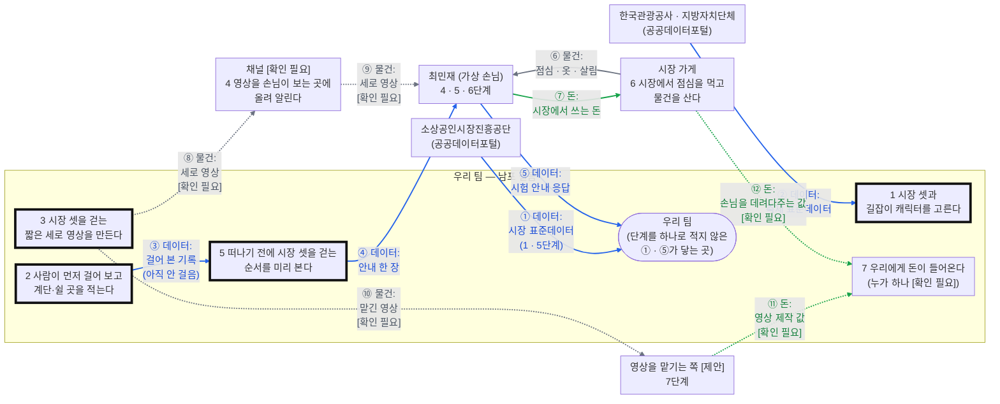

# 밸류체인 지도 — 남포 걸음 (2026-11-24 · sunghan)

- 그림의 단계는 `valuechain/steps.md` 표의 번호(1~7), 화살표 번호(①~⑫)는 `valuechain/flows.md` '2. 화살표 표'의 번호(1~12) 그대로입니다. 두 파일에 없는 단계 · 화살표 · 회사는 넣지 않았습니다.
- 실선 = flows.md에서 실선 · 점선 = flows.md에서 점선([제안] 또는 [확인 필요]). 점선 이름 뒤에 [확인 필요]를 붙였습니다.
- 굵은 테두리 = 우리 팀이 닿는 단계(steps.md에서 '예'): 1 · 2 · 3 · 5. 4 · 7은 steps.md에서 [확인 필요], 6은 '아니요'라 굵게 하지 않았습니다.
- 색(그림은 `map.html`에서): 데이터 = 파랑 · 물건 = 회색 · 돈 = 초록.
- 화살표를 어느 상자에 이었나: flows.md가 단계 하나를 적은 곳은 그 단계 상자에, "우리 팀"이라고만 적었거나 단계를 둘 적은 곳(①은 1 · 5단계, ⑤는 단계 없음)은 우리 팀 테두리 안의 둥근 '우리 팀' 상자에 이었습니다(단계 상자가 아닙니다). ⑪ · ⑫는 flows.md에 「우리 팀 (7단계)」라서 7단계 상자를 우리 팀 테두리 안에 두었지만, steps.md에서 7단계의 '누가 하나'는 [확인 필요]입니다.

## 화살표마다 근거 (flows.md '2. 화살표 표' 그대로)

| 번호 | 어디서 | 어디로 | 무엇이 | 실선 · 점선 | 근거(파일 이름:줄 번호와 원문 한 구절) |
|---|---|---|---|---|---|
| 1 | 소상공인시장진흥공단 (공공데이터포털) | 우리 팀 (1 · 5단계) | 데이터 — 전국전통시장표준데이터 | 실선 | `sunghan/brand/one-page.md:21` 「데이터: 전국전통시장표준데이터(소상공인시장진흥공단, 기준일 2026-11-09)」 · `.claude/skills/nampo-geoleum/markets.md:3` 「공공데이터포털 전국전통시장표준데이터(제공 소상공인시장진흥공단」 |
| 2 | 한국관광공사 · 지방자치단체 (공공데이터포털) | 우리 팀 (1단계) | 데이터 — 전국문화축제표준데이터 | 실선 | `sunghan/research/2026-11-19-data-license.md:11` 「제공기관 「한국관광공사, 지방자치단체」」 · `sunghan/brand/persona.md:36` 「유라리 건맥축제,유라리광장+남포동건어물도매시장」 (A05를 고른 근거 원문) |
| 3 | 우리 팀 — 걸어 본 사람 (2단계) | 우리 팀 — AI가 쓰는 안내 (5단계) | 데이터 — 계단 · 쉴 곳을 적은 기록 | 실선 (아직 안 걸음) | `sunghan/brand/one-page.md:36` 「사람이 한 번 걸어 보고 계단·쉴 곳을 적은 뒤, AI가 그 기록과 원문 값만으로 안내 한 장을 씁니다.」 — 아직 걷지 않았습니다(`steps.md:14`) |
| 4 | 우리 팀 (5단계) | 최민재 | 데이터 — 시장 셋을 걷는 순서 · 직선거리 · 공중화장실 여부를 담은 안내 한 장 | 실선 | `sunghan/brand/one-page.md:3` 「떠나기 전에 시장 사이 길에서 아는 것과 모르는 것을 미리 볼 수 있게」 · `one-page.md:15` 「구간마다 직선거리와 공중화장실 여부를 붙입니다」 — 손님에게 전하는 길(웹페이지 · 앱)은 [확인 필요]: `storyboard.md:32` 「누를 곳(웹페이지·앱·예약 링크)이 팀 자료에 없음」 |
| 5 | 최민재 (시험 안내를 읽은 사람) | 우리 팀 | 데이터 — "계단 · 쉴 곳을 미리 알았다"는 응답 | 실선 | `sunghan/brand/one-page.md:32` 「시험 안내를 읽은 사람 가운데 "계단·쉴 곳을 미리 알았다"고 답한 사람 수」 — 몇 명에게 물을지는 같은 줄에 [확인 필요] |
| 6 | 시장 가게 (6단계) | 최민재 | 물건 — 점심, 옷 · 신발 · 살림 | 실선 | `.claude/skills/nampo-geoleum/markets.md:14` 「의류/신발+가정용품+음식점업+기타소매업」 (A03 국제시장) · `sunghan/brand/persona.md:59` 「시장·먹거리만 식사 시간 포함」 |
| 7 | 최민재 | 시장 가게 (6단계) | 돈 — 시장에서 쓰는 돈 | 실선 | `sunghan/industry/my-place.md:30` 「손님이 시장에서 쓰는 돈은 가게로 가고 우리에게 오지 않습니다.」 |
| 8 | 우리 팀 (3단계) | 채널 (4단계) | 물건 — 40초 세로 영상 | 점선 | [확인 필요] — 채널을 정한 파일이 없음: `LOCAL.md:30` 「`story/channels.md` \| 핵심 메시지 하나를 네 채널로 \| 8일차 2교시 \| 없음」 · `storyboard.md:1` 「`sunghan/story/channels.md`는 폴더에 없음」 |
| 9 | 채널 (4단계) | 최민재 | 물건 — 40초 세로 영상 | 점선 | [확인 필요] — 8번과 같음. 보는 사람이 최민재라는 줄만 있음: `storyboard.md:3` 「**보는 사람:** 최민재」 |
| 10 | 우리 팀 (3단계) | 영상을 맡기는 쪽 (7단계) | 물건 — 맡긴 영상 | 점선 | `sunghan/industry/my-place.md:15` 「숏폼(세로 영상) 시리즈와 그 캐릭터 **[제안]**」 |
| 11 | 영상을 맡기는 쪽 | 우리 팀 (7단계) | 돈 — 영상 제작 값 | 점선 | `sunghan/industry/my-place.md:16` 「영상 제작을 맡기는 값 **[제안 · 파일에 근거 없음]**」 |
| 12 | 시장 가게 | 우리 팀 (7단계) | 돈 — 손님을 데려다주는 값 | 점선 | `sunghan/industry/my-place.md:30` 「손님을 데려다주는 값을 내는 시장 가게 쪽 **[제안 · 파일에 근거 없음]**」 |

- 세어 본 것: 실선 7 (①~⑦) · 점선 5 (⑧~⑫). 데이터 5 · 물건 4 · 돈 3. 우리 팀으로 들어오는 돈은 실선이 없습니다(flows.md '3. 세어 본 것').

## 사람이 할 일

1. 그림의 화살표 번호를 위 표에서 찾고, 근거 칸의 원문 구절을 그 파일에서 `Ctrl`+`F`로 찾아봅니다.
2. 화살표가 틀린 상자에 이어졌으면 위 Mermaid 글과 `map.html` 안의 같은 글을 함께 고칩니다(두 곳의 글은 같습니다).
