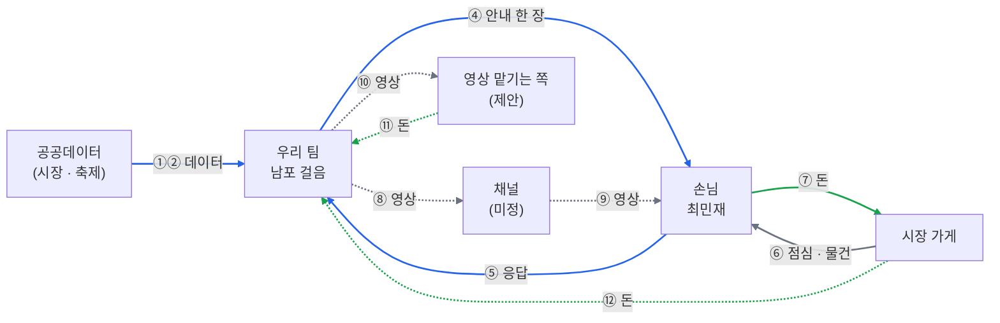

# 밸류체인 지도 — 남포 걸음 (간단판 · 2026-11-24)

**보는 법:** 실선 = 확정 · 점선 = 아직 미정 · 파랑 = 데이터 · 회색 = 물건 · 초록 = 돈

| 번호 | 무엇이 | 어디서 → 어디로 | 상태 |
|---|---|---|---|
| ① | 시장 데이터 | 소상공인시장진흥공단 → 우리 팀 | 확정 |
| ② | 축제 데이터 | 한국관광공사 · 지자체 → 우리 팀 | 확정 |
| ③ | 걸어 본 기록 | 팀 안 (2단계 → 5단계, 그림에서 뺌) | 아직 안 걸음 |
| ④ | 안내 한 장 | 우리 팀 → 최민재 | 확정 |
| ⑤ | "미리 알았다" 응답 | 최민재 → 우리 팀 | 확정 |
| ⑥ | 점심 · 물건 | 시장 가게 → 최민재 | 확정 |
| ⑦ | 시장에서 쓰는 돈 | 최민재 → 시장 가게 | 확정 |
| ⑧⑨ | 세로 영상 | 우리 팀 → 채널 → 최민재 | 채널 미정 |
| ⑩ | 맡긴 영상 | 우리 팀 → 영상 맡기는 쪽 | 제안 |
| ⑪ | 영상 제작 값 | 영상 맡기는 쪽 → 우리 팀 | 제안 |
| ⑫ | 손님 데려다주는 값 | 시장 가게 → 우리 팀 | 제안 |

**한 줄 요약:** 우리 팀으로 들어오는 돈(⑪ ⑫)은 아직 전부 점선입니다.

근거(파일 · 줄 번호)와 단계별 상자가 있는 원래 그림은 `map-detail.md` · `map-detail.html`에 그대로 있습니다.
